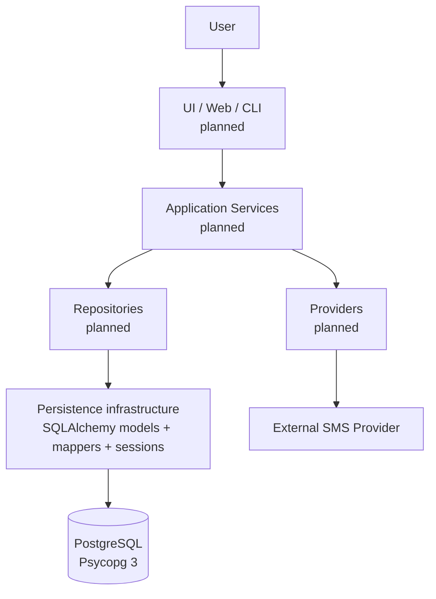

# Conceptual Architecture

The service, repository, provider, UI, and SMS nodes are planned only. MISSION-004 implements the persistence infrastructure and PostgreSQL target; it does not create repositories or connect to an SMS provider.
