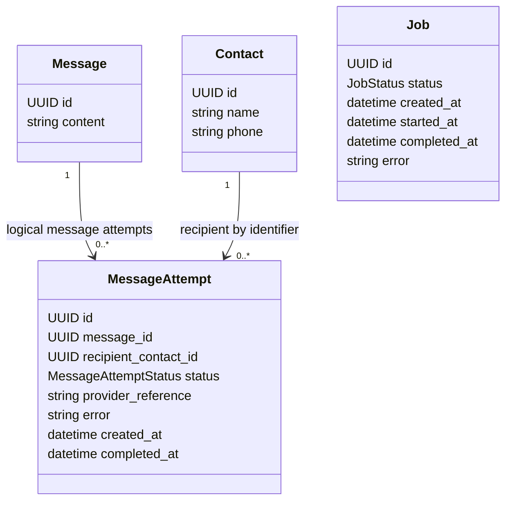

# Domain Model

MISSION-002 implements these minimal domain fields. Optional values may be absent. MessageAttemptStatus is pending/sent/failed; JobStatus is pending/running/completed/failed. The attempt references message and recipient by UUID, not by persistence or provider models. `Job` intentionally has no execution engine or work relationship yet.
